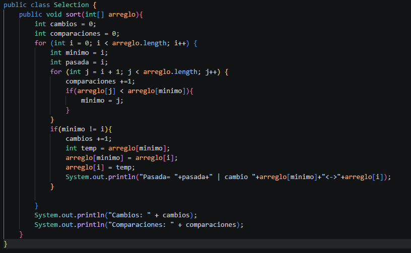
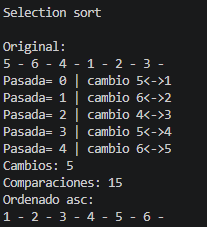

1. 
2. Pasada se va sumando cada que el bucle for recorre el arreglo, se toma los valores de los intercambios en posición "minimo" y posición "i" para la impresión de los números que se intercambian
3. 